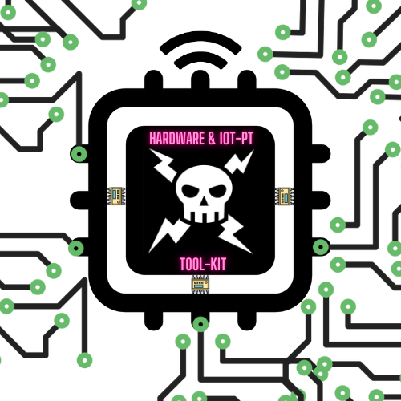

<p align="center">
  
</p>

<h1 align="center">Hardware-PT Toolkit</h1>

<p align="center">
  A one-command setup for hardware penetration testing, firmware analysis, and reverse engineering on Kali Linux.
</p>

---

## Overview

Hardware-PT Toolkit is a Bash installer that prepares a fresh Kali Linux system for hardware security work. It installs a curated set of more than 100 packages from the official Kali repository and builds two firmware analysis tools from source. When it finishes, it prints a clear report of what was installed, what was already present, and what failed.

It is designed for:

- Embedded and IoT security assessments
- Firmware extraction and static analysis
- Debug interface work over UART, JTAG, SWD, SPI, and I2C
- Binary reverse engineering and emulation

## Features

- **Kali-native.** Every package comes from the Kali rolling repository, and the script checks that it is running on Kali before making changes.
- **Safe to re-run.** Installed packages are skipped, and source tools are rebuilt only when upstream changes.
- **Unattended.** Package configuration prompts are handled automatically, so the run never stops for input.
- **Resilient.** One failed package does not stop the run. Failures are listed at the end, and the script exits with a non-zero status.
- **No unexpected upgrades.** The system is only upgraded when you pass `--upgrade`.

## Requirements

| Requirement | Details |
|---|---|
| Operating system | Kali Linux rolling (latest). Other systems are rejected. |
| Privileges | A user with `sudo` access, or root |
| Network | Internet access to the Kali mirrors and GitHub |
| Disk space | About 10 GB free is recommended. Ghidra, QEMU, and the JDK are large. |
| Architecture | amd64 is fully supported. On ARM, any unavailable package is skipped and reported. |

## Quick Start

```bash
git clone https://github.com/cybermax560-exe/Hardware-PT-ToolKIT.git
cd Hardware-PT-ToolKIT
chmod +x Hardware-PT-ToolKIT.sh
./Hardware-PT-ToolKIT.sh --upgrade
```

Using `--upgrade` is recommended unless the system was updated recently. Kali is a rolling release, and installing packages on an outdated system often causes dependency errors.

## Usage

```text
./Hardware-PT-ToolKIT.sh [options]
```

| Option | Description |
|---|---|
| `--upgrade` | Run `apt-get full-upgrade` before installing tools |
| `--no-source` | Skip the tools built from source (moria and mithril) |
| `-h`, `--help` | Show the help message |

### What the Script Does

1. Confirms that the system is Kali Linux.
2. Refreshes the package lists, and upgrades the system if `--upgrade` is set.
3. Installs each tool group from the Kali repository.
4. Clones moria and mithril into `~/.local/src`, then builds and installs them into `~/.local/bin`.
5. Prints a summary and any post-install steps that still need your attention.

## Included Tools

### Reverse Engineering

| Tool | Purpose |
|---|---|
| Ghidra | Disassembler and decompiler |
| radare2, rizin | Command-line reverse engineering frameworks |
| gdb, gdb-multiarch | Debugging for native and cross-architecture targets |
| jadx, apktool | Android APK decompiling and rebuilding |
| binutils-multiarch | objdump, readelf, and related tools for many architectures |
| ltrace, strace | Library and system call tracing |
| patchelf, nasm, upx | ELF patching, assembly, and executable unpacking |
| checksec | Checks binary hardening (RELRO, NX, PIE, stack canaries) |
| pwntools, capstone, keystone, unicorn | Python libraries for exploitation, disassembly, assembly, and CPU emulation |
| hexedit, xxd, hexdump | Hex viewing and editing |
| yara | Pattern matching for binaries and malware |
| QEMU | User-mode and full-system emulation for ARM, MIPS, and other architectures |

### Firmware Analysis

| Tool | Purpose |
|---|---|
| [moria](https://github.com/nmatt0/moria) | Firmware identification and extraction, built from source |
| [mithril](https://github.com/nmatt0/mithril) | Static scanner for secrets, SBOMs, CVEs, licenses, and boot security, built from source |
| binwalk | Firmware signature scanning and extraction |
| firmware-mod-kit | Firmware unpacking and repacking |
| dd | Raw image carving and copying (from coreutils) |
| squashfs-tools, sasquatch | Standard and vendor-modified SquashFS extraction |
| mtd-utils, ubi-reader, jefferson | UBI, UBIFS, and JFFS2 flash filesystems |
| cramfsswap, erofs-utils, f2fs-tools, e2fsprogs | CramFS, EROFS, F2FS, and ext2/3/4 filesystems |
| u-boot-tools, device-tree-compiler | U-Boot images and device tree blobs |
| cpio, lzop, lz4, zstd, xz-utils, 7zip | Archive and compression formats |
| fdisk, kpartx | Partition table inspection and mapping |
| foremost | File carving |

### Hardware Hacking

| Tool | Purpose |
|---|---|
| OpenOCD | JTAG and SWD debugging and flash programming |
| urjtag | JTAG boundary scan |
| flashrom | Reading and writing SPI flash chips |
| avrdude, dfu-util, stlink-tools, esptool | Programmers for AVR, USB DFU, STM32, and ESP32/ESP8266 |
| minicom, picocom, tio, screen, setserial | Serial and UART consoles |
| sigrok, sigrok-cli, PulseView | Logic analyzer capture and protocol decoding |
| i2c-tools, spi-tools, gpiod | I2C, SPI, and GPIO access |
| can-utils | CAN bus tools |
| libnfc, mfoc | NFC tools and MIFARE Classic key recovery |
| bluez, ubertooth | Bluetooth and Bluetooth LE |
| hackrf, rtl-sdr | Software-defined radio |
| usbutils, pciutils | USB and PCI device enumeration |
| pyserial, smbus, pyusb, libusb | Python and C libraries for custom hardware scripts |

### Network and Password Auditing

| Tool | Purpose |
|---|---|
| Wireshark | Packet capture and protocol analysis |
| nmap | Host and service discovery |
| bettercap, Ettercap | Network monitoring and man-in-the-middle testing |
| John the Ripper, hashcat | Password hash auditing |

### Base and Build Dependencies

git, curl, wget, the default JDK, zip, unzip, python3-pip, python3-venv, CMake, build-essential, pkg-config, and the zlib, liblzma, lz4, and zstd development libraries.

## Post-Installation

**Add `~/.local/bin` to your PATH.** moria and mithril are installed there. The script reminds you if the folder is missing from your PATH:

```bash
echo 'export PATH="$HOME/.local/bin:$PATH"' >> ~/.zshrc
source ~/.zshrc
```

**Use serial adapters without sudo:**

```bash
sudo usermod -aG dialout "$USER"
```

**Capture with Wireshark as a non-root user:**

```bash
sudo dpkg-reconfigure wireshark-common
sudo usermod -aG wireshark "$USER"
```

Log out and back in after changing group membership.

**Download the mithril CVE database** before running CVE scans:

```bash
mithril --fetch-db
```

## Example Workflow

```bash
# Identify and extract a firmware image
moria firmware.bin
moria -e firmware.bin

# Scan the extracted filesystem for secrets, SBOM data, and CVEs
mithril firmware.bin.extracted/

# Connect to a UART console at 115200 baud
picocom -b 115200 /dev/ttyUSB0

# Dump a SPI flash chip with a CH341A programmer
flashrom -p ch341a_spi -r dump.bin
```

## Troubleshooting

| Problem | Solution |
|---|---|
| Dependency or "held broken packages" errors | Run the script again with `--upgrade` |
| A package appears under "Skipped" | It is not available for your architecture or conflicts with an installed package. Install it manually if you need it. |
| moria or mithril fails to build | Check the CMake output above the summary, then run the script again |
| `~/.local/src/<tool> exists but is not a git checkout` | Move or delete that folder, then run the script again |
| `moria: command not found` | Add `~/.local/bin` to your PATH, as shown above |

## Disclaimer

This toolkit is intended for authorized security testing, research, and education only. Use it only on hardware, firmware, and networks that you own or have explicit written permission to test. You are responsible for complying with all applicable laws.

## Acknowledgements

- [moria](https://github.com/nmatt0/moria) and [mithril](https://github.com/nmatt0/mithril) by nmatt0
- The Kali Linux team and the maintainers of every included tool
